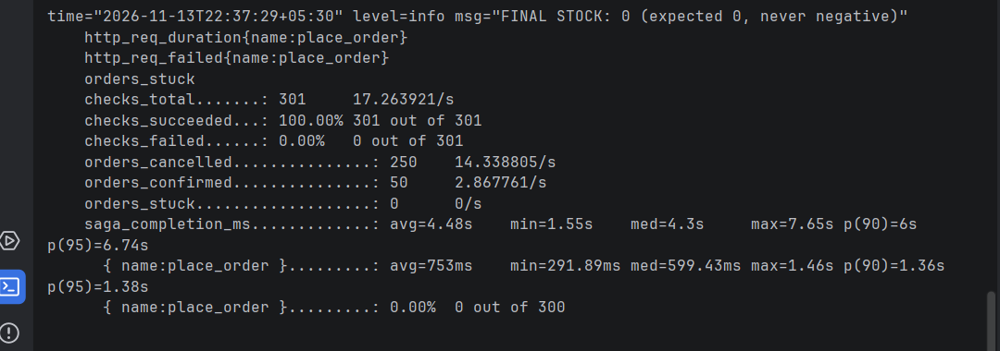
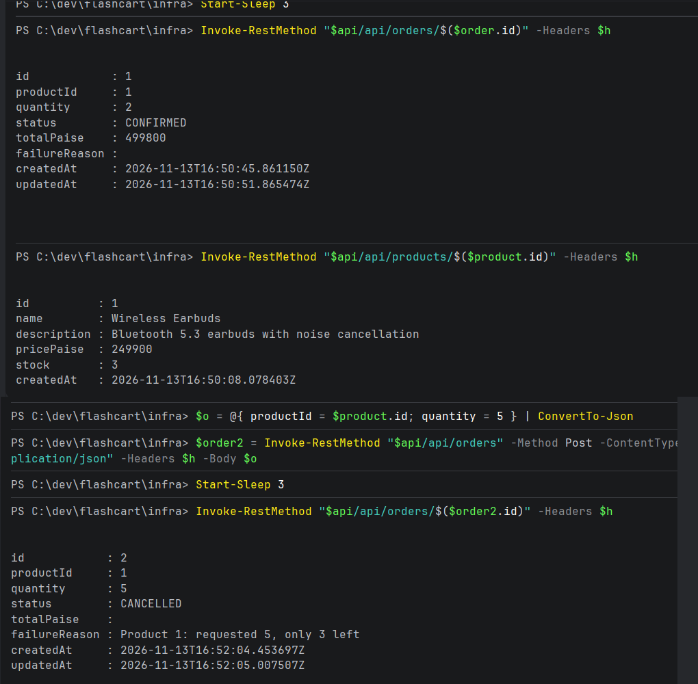
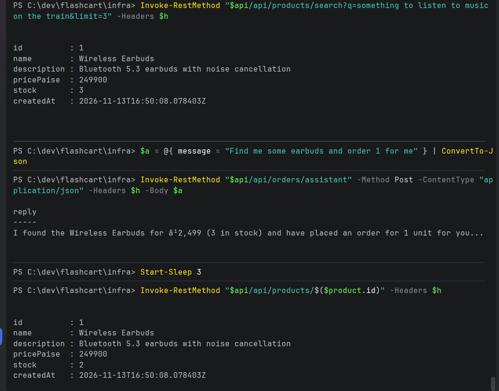

# FlashCart ⚡


**An event-driven flash-sale platform built with Spring Boot microservices, Kafka, and AI, deployed on AWS with Terraform.**

Flash sales are a classic hard problem: thousands of shoppers race for a few units, and the system must **never sell stock it doesn't have**. FlashCart solves it with a Kafka-based saga, the transactional outbox pattern, and optimistic locking, and proves it under load.

## Results

Load-tested **on AWS** with k6: **300 concurrent orders for 50 units**.

| Metric | Result |
|---|---|
| Confirmed / Cancelled | **exactly 50 / 250** |
| Final stock | **0** (zero overselling) |
| Failed requests | **0.00%** |
| Orders stuck in PENDING | **0** |
| Place-order latency | p50 **599 ms**, p95 **1.38 s** (India → Sydney, 0.5 vCPU tasks) |



## Architecture

```mermaid
flowchart LR
    C[Client] --> ALB[AWS ALB]
    ALB --> GW[API Gateway]
    GW --> AUTH[auth-service]
    GW --> INV[inventory-service]
    GW --> ORD[order-service]
    AUTH --> DB1[(auth_db)]
    ORD -->|"order + outbox (1 tx)"| DB3[(order_db)]
    ORD -->|order.placed| K{{Kafka}}
    K -->|order.placed| INV
    INV -->|"stock.reserved / stock.rejected"| K
    K --> ORD
    INV --> DB2[("inventory_db + pgvector")]
    INV --> R[(Redis cache)]
    ORD -.->|AI tool calls| INV
    INV -.-> AI[Gemini]
    ORD -.-> AI
```



### The order saga

1. **order-service** saves the order (`PENDING`) **and** an outbox row in **one database transaction**, then returns `202 Accepted`.
2. An **outbox relay** publishes `order.placed` to Kafka (keyed by `productId`).
3. **inventory-service** reserves stock with **optimistic locking** and replies `stock.reserved` or `stock.rejected`.
4. **order-service** moves the order to `CONFIRMED` or `CANCELLED`.



## Features

**Security**
- JWT (HS256) access tokens (15 min) with **rotating, revocable refresh tokens** (SHA-256 hashed)
- BCrypt passwords, role-based access (`CUSTOMER` / `ADMIN`), IDOR protection, RFC 9457 error responses

**Reliability**
- **Transactional outbox**: no lost or phantom events (`FOR UPDATE SKIP LOCKED` relay)
- **Idempotent consumers**: safe under Kafka's at-least-once delivery
- **Dead-letter topic** for poison messages, retry with backoff and jitter
- Three layers against overselling: Kafka partition ordering → `@Version` optimistic locking → `CHECK (stock >= 0)`

**AI (Spring AI + Gemini)**
- **Semantic product search** with pgvector (768-dim embeddings, HNSW index)
- **Shopping assistant** with tool calling: it finds products and places real orders through the same saga, bound to the caller's JWT identity



**Observability**
- Prometheus metrics and Grafana dashboards **provisioned as code**
- Distributed tracing with OpenTelemetry + Jaeger, with **trace context carried through Kafka via the outbox**
- Redis cache-aside for product reads, with hit-ratio metrics


## Tech stack

| Area | Technology |
|---|---|
| Language / framework | Java 21, Spring Boot 4.1, Spring Cloud Gateway, Spring AI 2.0 |
| Messaging | Apache Kafka 4.2 (KRaft) |
| Data | PostgreSQL 16 + pgvector, Flyway, Redis 7.4 |
| Testing | JUnit 5, Mockito, Testcontainers, Awaitility, JaCoCo, k6 |
| DevOps | Docker, Docker Compose, GitHub Actions, GHCR |
| Cloud | AWS ECS Fargate, RDS, ALB, Cloud Map, SSM Parameter Store, CloudWatch, Terraform |
| Observability | Micrometer, Prometheus, Grafana, OpenTelemetry, Jaeger |

## Run locally

**Prerequisites:** Docker Desktop and a free [Gemini API key](https://aistudio.google.com/apikey).

1. Create a `.env` file in the project root:
   ```
   JWT_SECRET=<base64 string, at least 32 bytes>
   GEMINI_API_KEY=<your key>
   ```
2. Start everything:
   ```bash
   docker compose --profile app --profile observability up -d
   ```
3. Open:
   - API Gateway: http://localhost:8080
   - Grafana: http://localhost:3000
   - Prometheus: http://localhost:9090
   - Jaeger: http://localhost:16686

## Deploy to AWS

The infrastructure is defined in [`infra/`](infra) with Terraform: ECS Fargate services, RDS PostgreSQL, an Application Load Balancer, Cloud Map service discovery, and secrets in SSM Parameter Store.

```bash
cd infra
terraform init
terraform apply   # about 12 minutes
```

Only the gateway is public (behind the ALB). All other services, Kafka, Redis and RDS are reachable only inside the VPC.

## Load test

```bash
k6 run -e API=<url> -e ADMIN_EMAIL=<admin> -e ADMIN_PASSWORD=<password> loadtest/flash-sale.js
```

## Design decisions

- **Why a saga instead of a distributed transaction?** Two-phase commit couples services and blocks under failure. The saga keeps every service independently deployable, and the outbox keeps it consistent.
- **Why key Kafka messages by `productId`?** All orders for one product land on one partition and are processed in order, so contention is serialised by design. Different products still run in parallel.
- **Why `202 Accepted`?** The order is durable the moment it's saved; the client polls for the final state instead of holding a connection open during the saga.
- **Trade-offs in the AWS demo:** a single Kafka broker without persistent storage (production would use Amazon MSK), public subnets without a NAT gateway (cost), and a single-AZ database.