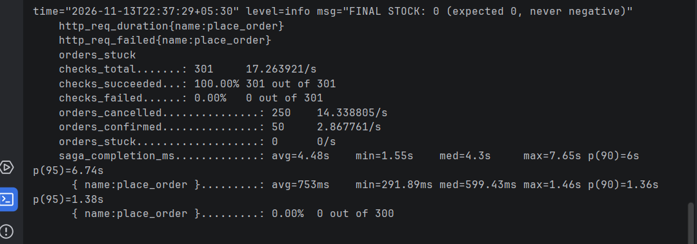
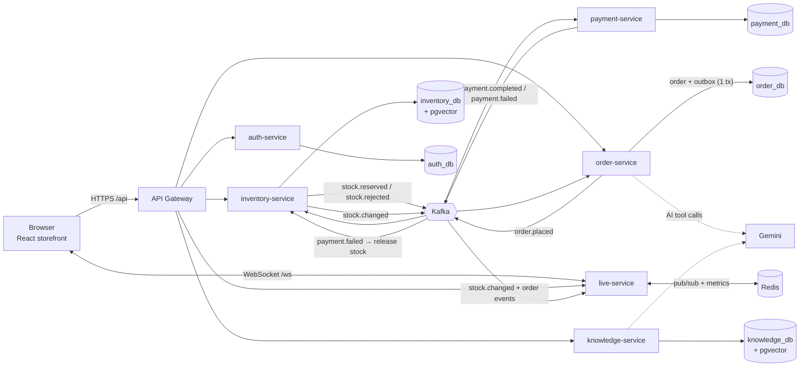
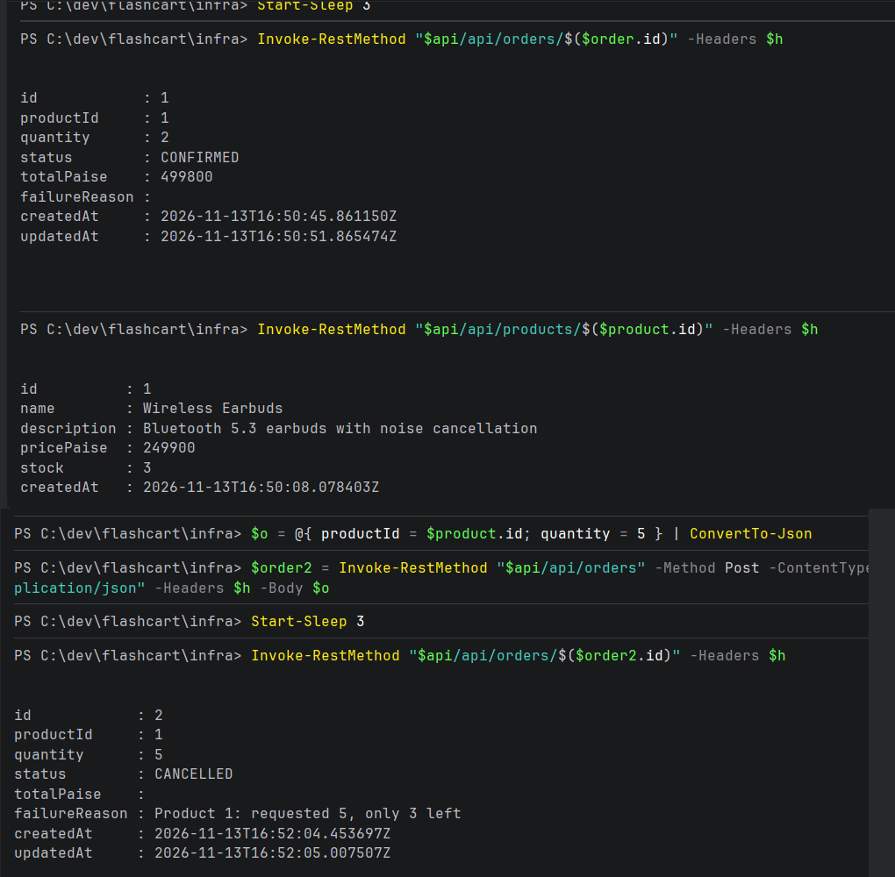
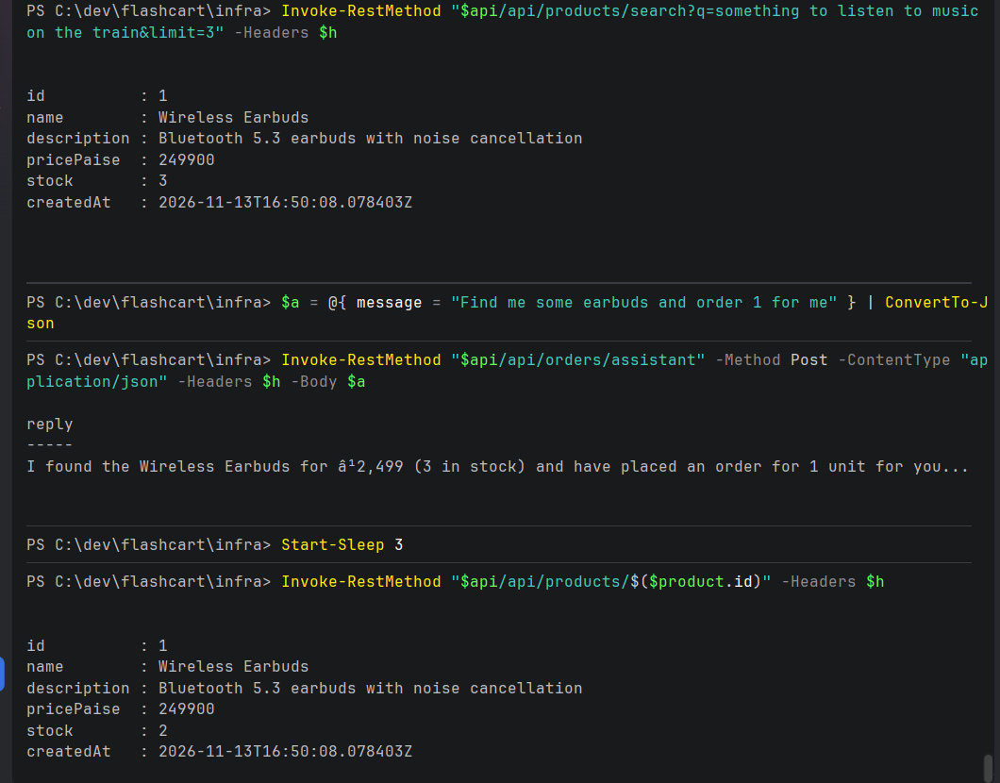

# FlashCart ⚡


**A real-time, event-driven flash-sale platform: Spring Boot microservices, Kafka sagas, live WebSocket updates, AI with RAG, a React storefront, and Kubernetes autoscaling, deployed on AWS with Terraform.**

Flash sales are a classic hard problem: thousands of shoppers race for a few units, everyone expects to see stock change the instant it happens, and the system must **never sell stock it doesn't have**. FlashCart solves this with a Kafka saga (reserve → pay → confirm, with compensation), the transactional outbox pattern, optimistic locking, and a Redis-backed WebSocket fan-out. Each of these is load-tested.

## Results

| What was measured | Result |
|---|---|
| **Overselling**: 300 concurrent orders for 50 units, AWS ECS | **exactly 50 confirmed, 0 oversold**, 0.00% errors, p95 1.38 s (India → Sydney) |
| **Autoscaling**: 7,201 orders at 30/s for 4 min, AWS EKS | HPA scaled order-service **1 → 3 pods in ~25 s**, **0 failed requests** through scale-up and scale-down |
| **Live updates**: stock change → every browser, 500 WebSocket viewers | **p95 39 ms**, median 23 ms, ~2,000 messages/s, every viewer received every update |
| **Storefront**: Lighthouse | **100 / 100 / 100 / 100** desktop, 96 / 100 / 100 / 100 mobile, **≈ 78 kB** gzipped |
| **RAG policy Q&A**: 14-question golden set | **11/11** retrieval, **11/11** correct answers, **3/3** refusals |

Details: [`loadtest/RESULTS-eks.md`](loadtest/RESULTS-eks.md) · [`loadtest/RESULTS-live.md`](loadtest/RESULTS-live.md)



## Architecture



### Services

| Service | Port | Data | Responsibility |
|---|---|---|---|
| gateway | 8080 | — | Spring Cloud Gateway, single entry point for `/api/**` |
| auth-service | 8081 | auth_db | Register and log in, JWT access tokens, rotating refresh tokens |
| inventory-service | 8082 | inventory_db + pgvector, Redis cache | Products, stock reservation, semantic search, `stock.changed` events |
| order-service | 8083 | order_db | Orders, saga orchestration, transactional outbox, AI shopping assistant |
| payment-service | 8084 | payment_db | Mock payment gateway (configurable failure rate), idempotent charges |
| live-service | 8085 | Redis | Kafka → Redis pub/sub → WebSocket fan-out, live admin metrics |
| knowledge-service | 8087 | knowledge_db + pgvector | PDF/DOCX ingestion and RAG answers with citations |
| storefront | 8090 | — | React 19 + TypeScript SPA served by nginx |

### The order saga

1. **order-service** saves the order (`PENDING`) **and** an outbox row in **one database transaction**, then returns `202 Accepted`.
2. An **outbox relay** publishes `order.placed` to Kafka, keyed by `productId`.
3. **inventory-service** reserves stock with **optimistic locking** and replies `stock.reserved` or `stock.rejected`. The order moves to `AWAITING_PAYMENT` or `CANCELLED`.
4. **payment-service** charges the order and replies `payment.completed` or `payment.failed`.
5. On success the order becomes `CONFIRMED`. On failure it becomes `CANCELLED`, and inventory **releases the reserved stock exactly once** (compensation), so the unit goes back on sale.

Every consumer is idempotent, and out-of-order replies are handled. For example, a payment result that arrives before the reservation reply still confirms the order.



### Live stock updates

Every stock change (reserve, release, restock) is published to `stock.changed` **after the database commit** (`@TransactionalEventListener(AFTER_COMMIT)`), so viewers never see a value that was rolled back. Any live-service pod relays it to a **Redis pub/sub** channel, and **every** pod pushes it to its WebSocket clients. This lets the browsers be spread across any number of pods.

- Slow clients can't stall the broadcast (`ConcurrentWebSocketSessionDecorator` with send-time and buffer limits)
- The browser reconnects with exponential backoff and ignores out-of-order updates (newer timestamp wins)
- Open connections are exported as a Prometheus gauge (`flashcart.live.connections`)

## Features

**Storefront (React 19, Vite, TypeScript)**
- Flash-sale product grid with **live stock** and countdowns to scheduled sales (`saleStartsAt`)
- Cart with a per-order limit and an order history that refreshes on its own
- **Admin dashboard**: orders per second, confirmed and failed payments, rejections, revenue and a sold-out table, updated every 2 s
- **Ask FlashCart** panel: shopping assistant (Shop tab) and policy Q&A with citations (Help tab)
- Access token in memory, refresh token in `sessionStorage`, single-flight token refresh, stale-response guards
- Production image: nginx-unprivileged with runtime-templated upstream URLs; ESLint and type-checked in CI

**Security**
- JWT (HS256) access tokens (15 min) with **rotating, revocable refresh tokens** (SHA-256 hashed)
- BCrypt passwords, role-based access (`CUSTOMER` / `ADMIN`), IDOR protection, RFC 9457 error responses

**Reliability**
- **Transactional outbox**: no lost or phantom events (`FOR UPDATE SKIP LOCKED` relay)
- **Idempotent consumers**: safe under Kafka's at-least-once delivery
- **Saga compensation**: failed payments release stock exactly once
- **Dead-letter topics** for poison messages, retry with backoff and jitter
- Three layers against overselling: Kafka partition ordering → `@Version` optimistic locking → `CHECK (stock >= 0)`

**AI (Spring AI + Gemini)**
- **Semantic product search** with pgvector (768-dim embeddings, HNSW index)
- **Shopping assistant** with tool calling: it finds products and places real orders through the same saga, bound to the caller's JWT identity



### Policy Q&A with citations (RAG)

A separate **knowledge-service** answers questions about FlashCart's policies from uploaded PDF and DOCX documents.

- **Parsing:** Apache PDFBox (text per page) and Apache POI (DOCX text per heading, tables kept as rows); file type checked by magic bytes, not extension
- **Chunking:** ~800-character, sentence-aware chunks with 150-character overlap; chunks never cross a page or section, so every citation is exact
- **Ingestion:** SHA-256 de-duplication; document row and vectors written in one transaction; embeddings with Gemini (768-dim) in pgvector (HNSW, cosine)
- **Answering:** retrieve-first RAG; top-5 chunks above a 0.60 similarity threshold are given to Gemini as numbered sources; the answer cites them as [1], [2], and the API returns only the cited sources with file, page or section, snippet and score
- **No hallucination by design:** if nothing passes the threshold, it refuses without calling the model; if the sources don't answer the question, the prompt makes it refuse
- **Tested without an API key:** a deterministic fake embedding model plus real pgvector in Testcontainers; a mocked chat model proves unanswerable questions never reach the LLM
- **Evaluated:** a 14-question golden set (11 answerable, 3 out of scope): **11/11 retrieval hit rate, 11/11 correct answers, 3/3 refusals**

| Endpoint | Access |
| --- | --- |
| `POST /api/docs` (multipart `file`) | ADMIN |
| `GET /api/docs` | logged-in user |
| `POST /api/docs/ask` `{ "question": "..." }` | logged-in user |

**Observability**
- Prometheus metrics and Grafana dashboards **provisioned as code**
- Distributed tracing with OpenTelemetry + Jaeger, with **trace context carried through Kafka via the outbox**
- Redis cache-aside for product reads, with hit-ratio metrics

## Kubernetes

Manifests in [`k8s/`](k8s) run the whole platform on Kubernetes: a namespace, ConfigMap and Secret, a Deployment and Service per app with **startup, readiness and liveness probes** and CPU/memory limits, an **ingress-nginx** Ingress (`/api` → gateway, `/ws` → live-service, `/` → storefront, long timeouts for WebSockets), and **HorizontalPodAutoscalers** (autoscaling/v2) for order-service (1–3 pods) and live-service (1–2 pods).

- **Local:** [kind](https://kind.sigs.k8s.io/) with [`k8s/kind-config.yaml`](k8s/kind-config.yaml) (the Ingress is published on `localhost:8000`)
- **AWS:** [`infra-eks/`](infra-eks) creates an EKS cluster with a 2-node managed node group in Terraform; [`k8s/eks/10-data.yaml`](k8s/eks/10-data.yaml) runs Postgres, Kafka and Redis in the cluster for the demo

## Tech stack

| Area | Technology |
|---|---|
| Backend | Java 21, Spring Boot 4.1, Spring Cloud Gateway, Spring Security (OAuth2 resource server), Spring AI 2.0 |
| Frontend | React 19, TypeScript, Vite, ESLint, nginx |
| Messaging and real time | Apache Kafka 4.2 (KRaft), Redis pub/sub, WebSocket |
| Data | PostgreSQL 16 + pgvector, Flyway, Redis 7.4 |
| AI | Gemini (chat and embeddings), pgvector, Apache PDFBox, Apache POI |
| Testing | JUnit 5, Mockito, Testcontainers, Awaitility, JaCoCo, k6 (56 tests across 7 services) |
| DevOps | Docker, Docker Compose, GitHub Actions (test matrix + GHCR images), Kubernetes, kind, ingress-nginx, HPA |
| Cloud | AWS ECS Fargate, EKS, RDS, ALB, Cloud Map, SSM Parameter Store, CloudWatch, Terraform |
| Observability | Micrometer, Prometheus, Grafana, OpenTelemetry, Jaeger |

## Run locally

**Prerequisites:** Docker Desktop and a free [Gemini API key](https://aistudio.google.com/apikey).

1. Create a `.env` file in the project root:
   ```
   JWT_SECRET=<base64 string, at least 32 bytes>
   GEMINI_API_KEY=<your key>
   ```
2. Start everything:
   ```bash
   docker compose --profile app --profile observability up -d
   ```
3. Open:
   - Storefront: http://localhost:8090
   - API Gateway: http://localhost:8080
   - Grafana: http://localhost:3000
   - Prometheus: http://localhost:9090
   - Jaeger: http://localhost:16686

For frontend development, run `npm run dev` in [`storefront/`](storefront). Vite proxies `/api` to the gateway and `/ws` to live-service.

## Deploy

**AWS ECS (Fargate):** [`infra/`](infra) defines ECS services, RDS PostgreSQL, an Application Load Balancer, Cloud Map service discovery and SSM secrets.

```bash
cd infra
terraform init
terraform apply   # about 12 minutes
```

Only the gateway is public (behind the ALB). All other services, Kafka, Redis and RDS are reachable only inside the VPC.

**Kubernetes (kind or EKS):**

```bash
kubectl apply -f k8s/00-namespace.yaml
kubectl create secret generic flashcart-secrets -n flashcart \
  --from-literal=JWT_SECRET=... --from-literal=GEMINI_API_KEY=... --from-literal=SPRING_DATASOURCE_PASSWORD=...
kubectl apply -f k8s/01-config.yaml -f k8s/20-apps.yaml -f k8s/30-ingress.yaml -f k8s/40-autoscaling.yaml
```

## Load tests

| Script | What it tests |
|---|---|
| [`flash-sale.js`](loadtest/flash-sale.js) | 300 buyers race for 50 units; checks nothing is oversold |
| [`sustained.js`](loadtest/sustained.js) | Constant order rate for several minutes, to drive the autoscaler |
| [`live-viewers.js`](loadtest/live-viewers.js) | N WebSocket viewers plus buyers; measures stock change → screen latency |

```bash
k6 run -e API=<url> -e ADMIN_EMAIL=<admin> -e ADMIN_PASSWORD=<password> loadtest/flash-sale.js
```

## Design decisions

- **Why a saga instead of a distributed transaction?** Two-phase commit couples services and blocks under failure. The saga keeps every service independently deployable, the outbox keeps it consistent, and compensation undoes a reservation when payment fails.
- **Why key Kafka messages by `productId`?** All orders for one product land on one partition and are processed in order, so contention is serialised by design. Different products still run in parallel.
- **Why `202 Accepted`?** The order is durable the moment it's saved. The client follows the final state (live updates and order history) instead of holding a connection open during the saga.
- **Why Redis pub/sub between Kafka and the WebSockets?** Kafka delivers each event to one consumer in a group, but every live-service pod must reach its own browsers. Redis fans each update out to all pods, so the live tier scales horizontally.
- **Why publish `stock.changed` after commit?** Publishing inside the transaction could announce stock that is then rolled back.
- **Trade-offs in the cloud demos:** a single Kafka broker without persistent storage (production would use Amazon MSK), public subnets without a NAT gateway (cost), a single-AZ database, and in-cluster data stores on EKS.
